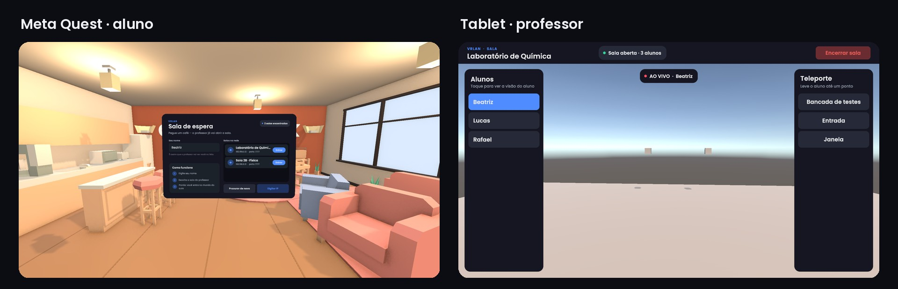
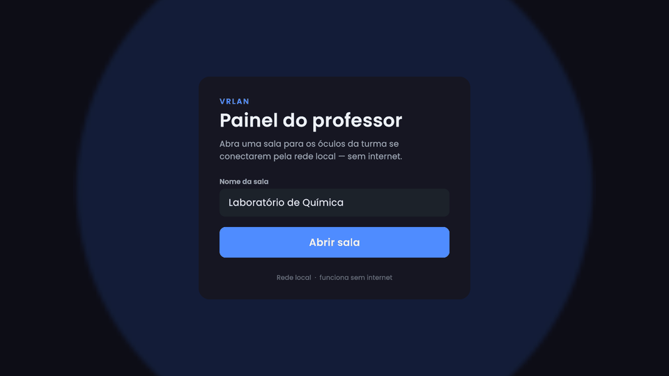
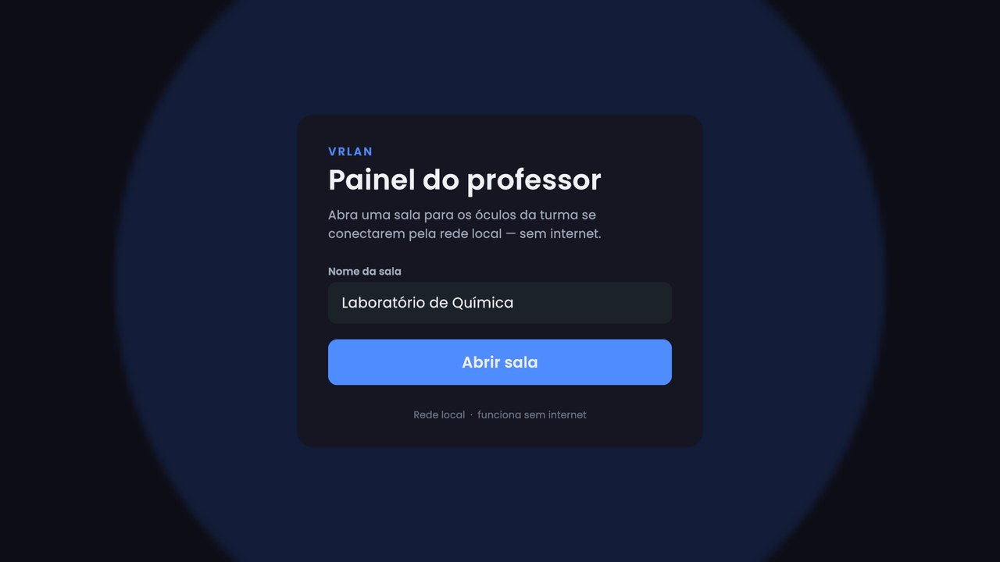
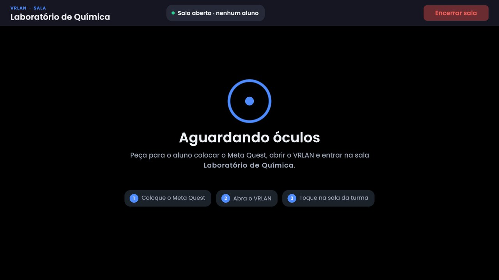
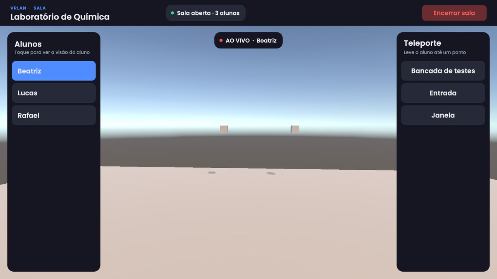
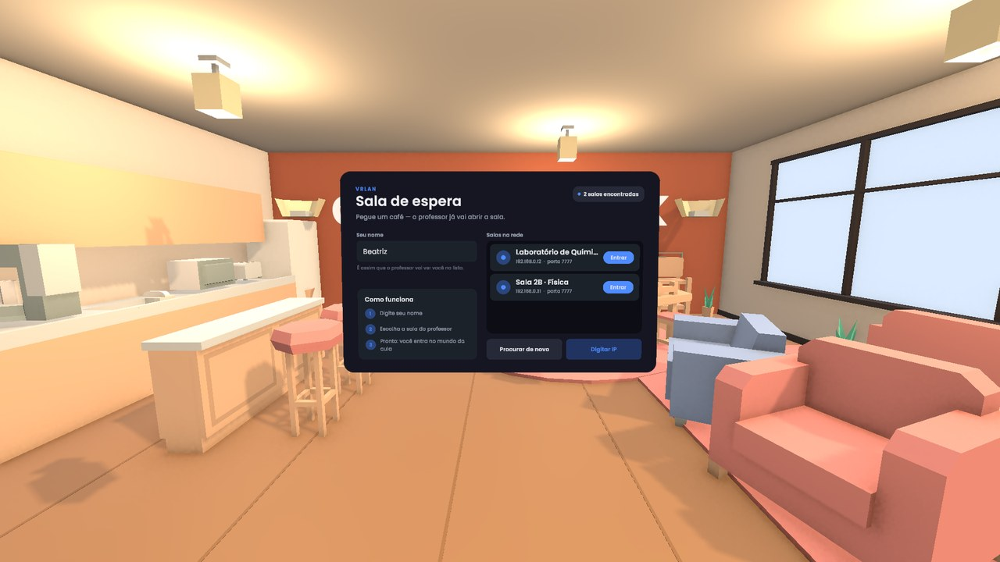
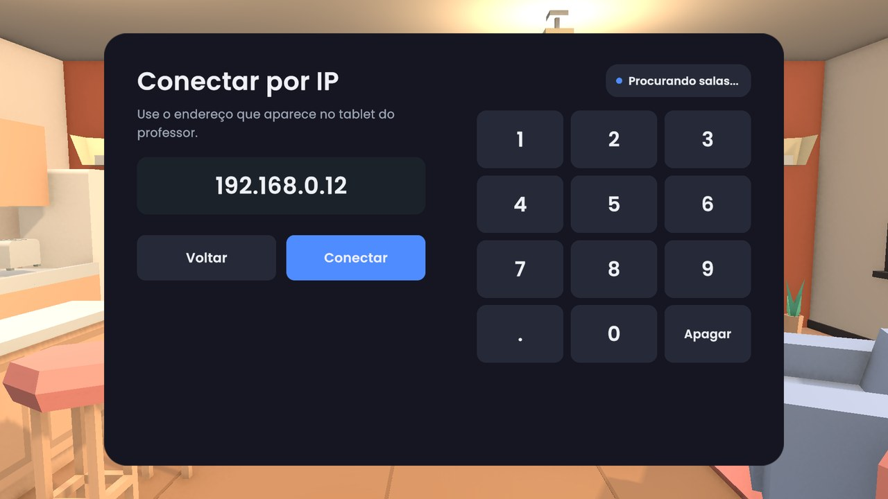
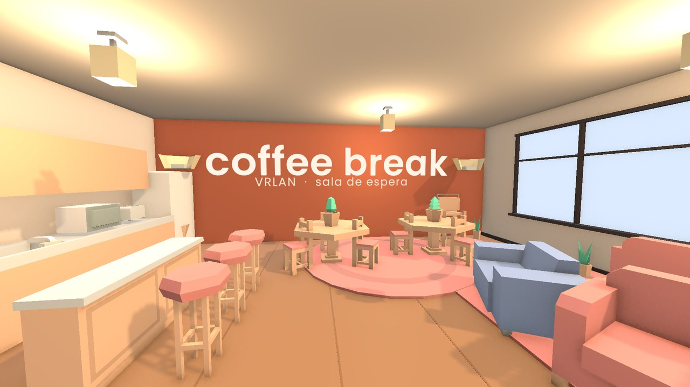
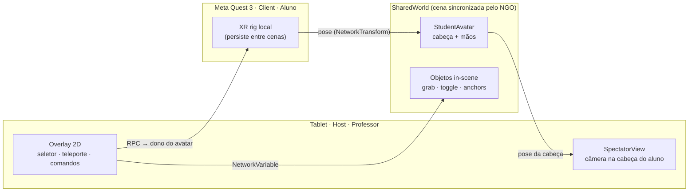

# VRLAN — VR multiplayer em rede local para sala de aula

**Um professor com um tablet vê, em tempo real, o que cada aluno vê dentro do óculos VR — e comanda a experiência: escolhe o aluno, teleporta, liga e desliga objetos. Tudo numa rede Wi-Fi local, sem internet.**




---

## O problema

Escolas públicas costumam ter internet instável ou inexistente, laboratórios sem equipamento e risco no manuseio de reagentes. Realidade Virtual resolve parte disso, mas as plataformas comerciais de VR educacional dependem de nuvem e cobram em dólar. E, dentro da sala, o professor perde o controle: não sabe o que o aluno está vendo dentro do óculos.

## A solução

O VRLAN é uma **camada modular** que entra **por cima de um projeto VR já existente** e adiciona:

| Recurso | Como funciona |
|---|---|
| **Visão do aluno no tablet** | O tablet renderiza o mundo pela pose da cabeça do aluno (câmera espectadora sincronizada), sem streaming de vídeo. É leve e escala para uma turma inteira. |
| **Seletor de aluno** | Lista dos alunos conectados (cada um digita o nome no óculos). Um toque troca a câmera e o alvo dos comandos juntos. |
| **Teleporte comandado** | O integrador marca pontos na cena com objetos vazios; o tablet gera um botão por ponto e leva o aluno até lá. |
| **Ligar/desligar objetos** | Estado replicado pelo servidor e controlado pelo professor. |
| **Objetos agarráveis em rede** | A posse passa para o aluno no momento do grab, então o movimento dele aparece para todos. |
| **Conexão sem configuração** | Descoberta automática do host na LAN por UDP broadcast; o óculos pode conectar sozinho no primeiro host que encontrar. |

O código **não depende do SDK de VR**: o mesmo plugin roda com XR Interaction Toolkit ou com Meta XR SDK. Trocar de SDK é ligar componentes na cena, não reescrever código. Ele já foi **integrado num projeto real de laboratório de química em VR** (Unity 2022 + NGO 1.x + Meta SDK).

---

## Telas

<p align="center"></p>

**Tablet (professor):** a sala começa fechada. Com a sala aberta e nenhum óculos conectado, a tela fica preta, e com um aluno conectado mostra a visão dele.

| Abrir a sala | Aguardando óculos | Ao vivo |
|---|---|---|
|  |  |  |

**Meta Quest (aluno):** a espera acontece numa sala de "coffee break", com o painel de conexão no mesmo padrão visual do tablet.

| Sala de espera | Conectar por IP | Coffee break |
|---|---|---|
|  |  |  |

<sub>Imagens renderizadas no Editor do Unity pela ferramenta do próprio projeto (menu VRLAN → Capture Previews), com dados de exemplo. Móveis: Kenney Furniture Kit (CC0). Fonte: Poppins (OFL).</sub>

---

## Arquitetura



**Três cenas:**
- **`TabletScene`**: a cena inicial do professor.
- **`QuestLobby`**: a cena inicial do aluno.
- **`SharedWorld`**: o mundo compartilhado, que é a cena do projeto VR de quem integra.

O Netcode gerencia **só** a `SharedWorld`, em modo *Single*. Tudo o que é de um aparelho específico atravessa a troca de cena com `DontDestroyOnLoad`: o rig VR no Quest; a câmera, o overlay e o EventSystem no tablet. Com isso o mundo compartilhado fica independente do aparelho, e qualquer cena VR existente pode virar a `SharedWorld`.

---

## Desafios técnicos resolvidos

Alguns problemas que o projeto precisou resolver, e o porquê de cada decisão:

- **Cenas aditivas corrompiam a sincronização.** A primeira arquitetura mantinha as cenas iniciais carregadas e somava o mundo por cima. O cliente rejeitava a cena do host, o mapa de cenas do NGO ficava inconsistente e os objetos da cena davam NullReferenceException. A solução foi **sincronizar uma única cena (Single sync)** e fazer só os objetos de cada aparelho persistirem entre cenas.
- **A descoberta de rede não funcionava no Android.** O sample oficial não cobre o caso. A descoberta foi escrita do zero em UDP, com **MulticastLock** (sem ele o Android descarta o broadcast) e **broadcast direcionado por interface** (`192.168.x.255`).
- **O teleporte VR enterrava o jogador.** A cabeça tem deslocamento dentro do rig, então mover o rig direto erra o lugar. O teleporte leva a **projeção da cabeça no chão** até o destino e gira o rig em torno da cabeça para acertar a direção.
- **O aluno não conseguia pegar objetos após a troca de cena.** Os interactors do XRI registram antes de os objetos agarráveis existirem. Um componente refaz o registro quando o mundo carrega.
- **O cliente era expulso 70 ms depois de conectar.** Host e cliente usavam listas de prefabs de rede diferentes e o hash do handshake não batia. Agora existe uma lista única e a geração automática está desligada.
- **"O tablet não vê o que o aluno vê."** O tablet renderiza a **própria cópia** da cena, então só o que é replicado aparece para ele. Isso virou a regra central para quem integra: todo estado visual que o professor precisa ver tem que ir pela rede.
- **Compatibilidade com dois Unity.** O plugin compila com NGO 2.x (Unity 6) e NGO 1.x (Unity 2022), usando *version defines* no asmdef e um assembly separado que só compila no NGO 1.x.

O catálogo completo, com mais de 30 armadilhas e a correção de cada uma, está em [`CONTEXTO.md`](CONTEXTO.md#7-armadilhas-conhecidas-catálogo-de-bugs-já-resolvidos).

---

## Stack

| | |
|---|---|
| Engine | Unity 6.3 (6000.3.13f1), URP 17.3 |
| Rede | Netcode for GameObjects 2.11 (Scene Management ON), Unity Transport (porta 7777) |
| Descoberta | UDP broadcast próprio (porta 47777) |
| VR | XR Interaction Toolkit 3.3 + OpenXR 1.16 (compatível com Meta XR SDK) |
| Input | Input System 1.19 |
| Plataforma | Meta Quest 3 (aluno) + tablet Android (professor), APK Android |

---

## Estrutura do repositório

```
Assets/VRLAN/              → o plugin (exportável como .unitypackage)
  Runtime/                 → código, asmdef VRLAN.Network
    Discovery/  Avatar/  Spectator/  Interaction/  Teleport/  UI/
    Compat1x/              → assembly que só compila no NGO 1.x (Unity 2022)
  Prefabs/                 → StudentAvatar, SessionManager, lista de prefabs de rede
  Samples/Scenes/          → TabletScene Teste, QuestLobby, SharedWorld
  Editor/                  → ferramentas: monta as UIs e a sala de espera, gera prévias
  UI/                      → sprites e fontes do tema visual
  README.md                → guia de integração (XRI e Meta SDK)
CONTEXTO.md                → documentação técnica: arquitetura, decisões, armadilhas
VRLAN_INTEGRACAO_LABPH.md  → diário da integração num projeto real (Unity 2022 + Meta SDK)
```

---

## Como rodar

1. Abrir o projeto no **Unity 6000.3.13f1**.
2. Para testar no Editor, use o **Multiplayer Play Mode**: uma instância abre `TabletScene Teste` e clica em **Host**, a outra abre `QuestLobby`.
3. Para gerar os builds:
   - **Quest:** OpenXR ligado, cena inicial `QuestLobby`.
   - **Tablet:** OpenXR desligado, cena inicial `TabletScene Teste`.

   O Build Profile `Android™` já lista as três cenas.
4. Coloque os aparelhos na **mesma rede Wi-Fi**. No tablet, toque em **Host**; o Quest acha o host sozinho.

Para integrar em outro projeto VR, siga o [guia de integração](Assets/VRLAN/README.md).

---

## Status

**Pronto**

- Descoberta e conexão LAN, câmera espectadora, avatar sincronizado (cabeça e mãos)
- Objetos da cena em rede, grab com troca de posse, teleporte comandado, seletor de aluno com nome
- Volta automática do aluno para a lobby se a conexão cair
- Compatível com NGO 1.x/2.x e com XRI/Meta SDK; já integrado num projeto real
- Interface do professor com estados (sala fechada, aguardando óculos, ao vivo) e sala de espera "coffee break" no Quest, geradas por ferramenta de Editor

**Em andamento**

- Painel de liga/desliga no tablet: o componente está pronto, falta o painel dinâmico
- Avatar com visual próprio, sem depender das Starter Assets do XRI

<!-- TODO: autoria / seu papel no projeto / contato -->
